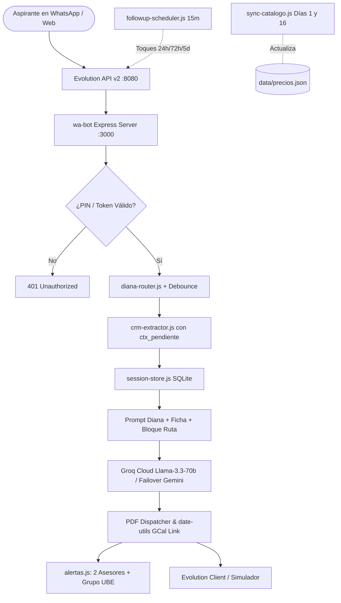

# WhaspiUBE · Asesora Académica Virtual UBE (Diana v5.2)

Sistema conversacional inteligente, CRM determinista de admisiones y protocolo de seguimiento anti-visto para WhatsApp y Web de la **Universidad Bolivariana del Ecuador (UBE)**. Diseñado para operar en producción 24/7 en servidores Linux mediante Docker Compose, con memoria persistente (Zero-Amnesia), capa de consistencia determinista y embudo consultivo de 4 turnos.

---

## 🚀 Novedades y Capacidades Principales (v5.2)

- **Capa de Consistencia & Enrutamiento Determinista (`diana-router.js`):**
  - Clasificación previa de intenciones (`precio_programa`, `programa_interes`, `area_elegida`, `catalogo_areas`, `triptico`, `llamada`, `saludo`).
  - Inyección dinámica de `[BLOQUE DE RUTA]` al prompt y sección obligatoria **#0 DÓNDE BUSCAR** en `prompt-engine.js`.
  - Bandera `ctx_pendiente` en base de datos: Diana recuerda exactamente qué preguntó (nombre, área u horario) eliminando la amnesia del turno previo y la repetición de menús.
- **Taxonomía Única y Matriz Oficial (`menu-service.js` + `data/precios.json`):**
  - Catálogo unificado con las 5 áreas oficiales: *Educación*, *Administración y Negocios*, *Derecho y Gobernanza*, *Ingeniería y Tecnología*, y *Salud y Bienestar*.
  - Solución definitiva al bug de «0 maestrías»: mapeo directo a las 48 maestrías activas de la matriz institucional.
- **Sincronización Quincenal de SharePoint (`sync-catalogo.js`):**
  - Descarga y comparación automática del archivo *INSCRIPCIONES UBE.xlsx* los días 1 y 16 de cada mes.
  - Detección de variaciones de aranceles, matrículas y nuevos cohortes sin reiniciar el servidor.
- **Diana 100% Texto (Cero TTS Saliente):**
  - Respuestas ultra-rápidas y cálidas en texto puro (eliminado Kokoro/Edge-TTS para optimizar recursos del servidor).
  - La transcripción de notas de voz entrantes del usuario mediante **Groq Whisper Large Turbo** se mantiene 100% operativa.
- **Integración con Google Calendar & iCal RFC 5545 (`date-utils.js`):**
  - Parser en lenguaje natural para fechas y horarios en zona horaria de Ecuador (`America/Guayaquil` UTC-5).
  - Generación de enlace de 1 clic para añadir la cita a Google Calendar directamente desde el WhatsApp de confirmación.
  - Endpoint suscribible para asesores: `GET /api/calendario/feed.ics?token=<token>`.
- **Alertas Duales Multi-Asesor y Grupo Institucional (`alertas.js`):**
  - Envío simultáneo de citas agendadas y fichas completas a los asesores (`+593 96 094 6956` y `+593 99 860 0136`).
  - Soporte para notificaciones al grupo oficial *«UBE - Better Together»* con deduplicación anti-tormenta de 10 minutos.
- **Control de Acceso PIN Gate 052020:**
  - Acceso institucional restringido al simulador web y protección a nivel de API mediante token temporal `x-panel-token`.
- **Campaña de Egresados Integrada (`campanas-crm.js` + `importar-campana.js`):**
  - Módulo de prospección para 355 graduados con reglas anti-baneo (6–9 envíos diarios, pausas de 50–110 min y ventanas laborales).
- **Validador Oficial de Cédula (Registro Civil de Ecuador):**
  - Algoritmo estricto módulo 10: provincia 01-24, tercer dígito < 6 (persona natural) y suma ponderada 2-1.
  - Filtro contextual contra números de teléfono celular (`09xxxxxxxx`).
- **Catálogo de 131 Trípticos Oficiales:**
  - Búsqueda tokenizada por palabras clave y despacho directo de PDFs organizados por facultades.

---

## 🏗️ Arquitectura de Producción (Docker)



---

## 📁 Estructura del Proyecto

```text
WhaspiUBE/
├── wa-bot/                         # Núcleo del Backend en Node.js
│   ├── server.js                   # Orquestador Express, Webhooks y API REST
│   ├── diana-router.js             # Capa de consistencia e intención
│   ├── menu-service.js             # Menús interactivos y taxonomía de 5 áreas
│   ├── sync-catalogo.js            # Sincronizador automático SharePoint
│   ├── date-utils.js               # Enlaces Google Calendar y feed RFC 5545
│   ├── alertas.js                  # Notificaciones a 2 asesores y grupo UBE
│   ├── campanas-crm.js             # Módulo de campaña masiva anti-baneo
│   ├── followup-scheduler.js       # Planificador de toques anti-visto (24h/72h/5d)
│   ├── prompt-engine.js            # Prompt maestro Diana y sección #0 DÓNDE BUSCAR
│   ├── session-store.js            # SQLite CRM, máquina de estados y llamadas
│   ├── crm-extractor.js            # Extractor determinista con Registro Civil
│   ├── pdf-service.js              # Buscador y despachador de trípticos PDF
│   ├── ai-provider.js              # Driver Groq Cloud con failover
│   ├── audio-processor.js          # Transcriptor Groq Whisper Turbo
│   ├── vision-handler.js           # Visión por computadora y RapidOCR
│   ├── wa-client.js                # Cliente HTTP para Evolution API v2
│   ├── material/                   # Catálogo de 131 PDFs oficiales (6 facultades)
│   ├── public/                     # Simulador Web interactivo con PIN Gate 052020
│   ├── data/                       # Precios de matriz, enlaces y memoria
│   ├── docker-compose.yml          # Orquestación de producción (Postgres, Redis, Evolution, Bot)
│   ├── docker-compose.gateway.yml  # Configuración auxiliar gateway
│   ├── Dockerfile                  # Imagen Docker optimizada (Node 22 + SQLite nativo)
│   └── package.json
├── docs/                           # Catálogos y manuales de referencia
├── scripts/                        # Utilidades y scrapers
└── README.md                       # Documentación principal
```

---

## 🚀 Despliegue en Servidor Linux (Producción)

### 1. Clonar el repositorio en el servidor:
```bash
cd /home/guto/ube-bot
git clone https://github.com/guilleguto-source/WhaspiUBE.git .
cd wa-bot
```

### 2. Configurar el archivo `.env`:
Copiar la plantilla de producción:
```bash
cp .env.example .env
```
Asegurar las siguientes variables en `.env`:
```env
PORT=3000
PANEL_PIN=052020

# Proveedor LLM
GROQ_API_KEY=tu_groq_api_key

# Gateway de WhatsApp (Evolution API v2)
EVOLUTION_API_URL=http://evolution-api:8080
EVOLUTION_API_KEY=ube_secret_key_2026
EVOLUTION_INSTANCE=ube-bot

# Alertas Multi-Asesor y Grupo
ASESOR_ALERTA_PHONE=593960946956,593998600136
ASESOR_GRUPO_NOMBRE=UBE - Better Together

# Trípticos en contenedor
UBE_MATERIAL_DIR=/app/material

# Seguridad
WEBHOOK_TOKEN=tu_token_seguro
TOQUES_ACTIVOS=true
```

### 3. Levantar con Docker Compose:
```bash
docker compose up -d --build
```

### 4. Vincular el número de WhatsApp:
1. Crear la instancia en Evolution API (si no existe):
   ```bash
   curl -X POST http://localhost:8080/instance/create \
     -H "apikey: ube_secret_key_2026" \
     -H "Content-Type: application/json" \
     -d '{"instanceName": "ube-bot", "qrcode": true, "integration": "WHATSAPP-BAILEYS"}'
   ```
2. Obtener el código QR en la consola o navegador y escanearlo con el celular oficial de admisiones UBE:
   ```bash
   curl http://localhost:8080/instance/connect/ube-bot -H "apikey: ube_secret_key_2026"
   ```

---

## 🧪 Verificación y Pruebas Automáticas

El proyecto incluye 6 baterías de pruebas con **257 checks unitarios y de integración**:
```bash
cd wa-bot
npm install
npm test
```
* **53 checks:** Embudo 4 turnos, cédula ecuatoriana y máquina de estados (`test-embudo.js`).
* **37 checks:** Menús interactivos, precios y saludo determinista (`test-v3.js`).
* **54 checks:** Sincronización y consistencia de la matriz SharePoint (`test-sync.js`).
* **41 checks:** Auditoría contra errores críticos C1-C6 (`test-auditoria.js`).
* **22 checks:** Campaña de egresados y límites anti-baneo (`test-campana.js`).
* **50 checks:** Diana texto, Google Calendar RFC 5545, Alertas duales y PIN Gate (`test-v52.js`).

---

## 📄 Licencia

Sistema desarrollado para la Universidad Bolivariana del Ecuador (UBE). Todos los derechos reservados.
