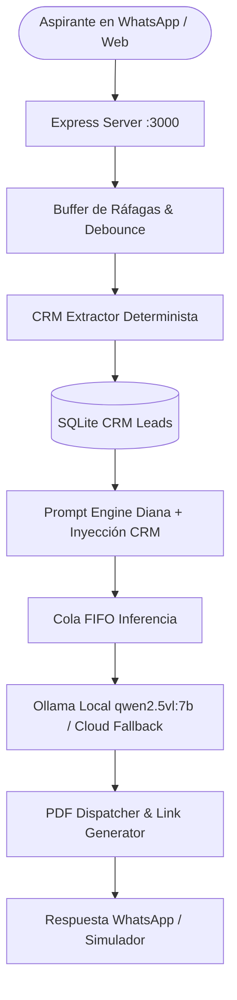

# WhaspiUBE · Asesora Académica Virtual UBE (Diana)

Sistema conversacional inteligente y CRM de admisiones para WhatsApp y Web de la **Universidad Bolivariana del Ecuador (UBE)**. Diseñado con arquitectura híbrida local/nube, memoria persistente determinista (Zero-Amnesia) y embudo de conversión consultivo en 4 turnos.

---

## 🚀 Características Principales

- **Embudo de Admisiones en 4 Turnos:**
  1. **T1 · Enganche:** Clasificación de interés (*empezar carrera, titular experiencia o maestría*).
  2. **T2 · Diagnóstico:** Captura de identidad (*Nombre y Ciudad*) y perfil formativo (*bachiller, docente o tercer nivel*).
  3. **T3 · Entrega de Valor:** Presentación de cuota oficial ($140/mes pronto pago), despacho de tríptico y gatillo de cédula para congelar arancel por 72h.
  4. **T4 · Cierre:** Confirmación de ficha consolidada y micro-compromiso (*reserva de cupo*).
- **Motor CRM Determinista (Zero-Amnesia):**
  - Registro de slots en SQLite (`crm_leads`): `nombre`, `ciudad`, `perfil`, `carrera`, `cedula`, `triptico_enviado`, `etapa`.
  - Extractor semántico específico para Ecuador (regex de cédulas 10 dígitos, catálogo de cantones/provincias, perfiles SENESCYT).
  - Inyección inmutable de la ficha CRM en el system prompt para eliminar la pérdida de atención del modelo 7B.
- **Despacho Inteligente de Trípticos (PDF):**
  - Filtrado por stop words y tokenización exacta de programas.
  - Fallback automático a la carrera activa en el CRM ante solicitudes ambiguas (*"mándame el folleto"*).
- **Debouncing y Cola de Inferencia Serializada:**
  - Agrupación de ráfagas de mensajes rápidos en WhatsApp (espera activa y ventana de gracia).
  - Cancelación/aborto de inferencias previas si el usuario sigue escribiendo.
  - Cola FIFO global para no saturar GPUs/VRAM en inferencia local.
- **Multimedia y Notas de Voz:**
  - Transcripción de audios de WhatsApp con **Groq Whisper Large Turbo**.
  - Reconocimiento óptico de caracteres (OCR) con **RapidOCR** para credenciales y certificados.
- **Simulador Web & Móvil:**
  - Interfaz de pruebas interactiva en `/` accesible desde red local para pruebas en iPhone/Android.

---

## 🏗️ Arquitectura del Sistema



---

## 📁 Estructura del Repositorio

```text
WhaspiUBE/
├── wa-bot/                         # Núcleo del Backend en Node.js
│   ├── server.js                   # Orquestador HTTP, cola FIFO y endpoints
│   ├── prompt-engine.js            # Prompt maestro y reglas de negocio SENESCYT
│   ├── session-store.js            # Base de datos SQLite y formateador de ficha CRM
│   ├── crm-extractor.js            # Extractor regex y de entidades de Ecuador
│   ├── pdf-service.js              # Buscador y despachador tokenizado de trípticos
│   ├── ai-provider.js              # Conector Ollama local + fallback Cloud
│   ├── audio-processor.js          # Procesador de notas de voz (Groq Whisper Turbo)
│   ├── vision-handler.js           # Orquestador de visión por computadora
│   ├── ocr-processor.py            # Script Python RapidOCR
│   ├── wa-client.js                # Cliente de conexión WhatsApp Web
│   ├── public/                     # Simulador Web interactivo
│   │   └── index.html
│   ├── data/                       # Catálogos scraped de la UBE en JSON
│   ├── Dockerfile & docker-compose.yml
│   └── package.json
├── docs/                           # Manuales y Documentación Estratégica
│   ├── catalogo_completo_carreras_ube.md
│   ├── arbol_respuestas_y_prompt_optimizacion.md
│   ├── UBE_Carreras_Grado.md
│   └── UBE_Maestrias_Posgrados.md
├── scripts/                        # Scripts de Scraping y Extracción UBE
│   ├── build_catalogo_md.js
│   ├── descargar_catalogo_ube.py
│   ├── descargar_drive_ube.py
│   ├── extraer_perfiles_acordeon.py
│   └── scrape_ube_full.py
└── README.md
```

---

## ⚙️ Requisitos Previos

- **Node.js** >= 18.x
- **Python** >= 3.10 (para OCR opcional con `rapidocr-onnxruntime`)
- **Ollama** con el modelo `qwen2.5vl:7b` (o configuración de API Key de Groq/OpenAI en `.env`)

---

## 🛠️ Instalación y Puesta en Marcha

1. **Clonar el repositorio:**
   ```bash
   git clone https://github.com/guilleguto-source/WhaspiUBE.git
   cd WhaspiUBE/wa-bot
   ```

2. **Instalar dependencias:**
   ```bash
   npm install
   ```

3. **Configurar variables de entorno:**
   Copiar `.env.example` a `.env`:
   ```bash
   cp .env.example .env
   ```
   Configurar los valores:
   ```env
   PORT=3000
   OLLAMA_HOST=http://127.0.0.1:11434
   OLLAMA_MODEL=qwen2.5vl:7b
   GROQ_API_KEY=tu_groq_api_key_aqui
   UBE_MATERIAL_DIR=C:\Ruta\A\Tripticos_PDF
   ```

4. **Iniciar Ollama:**
   ```bash
   ollama serve
   ```

5. **Iniciar el servidor de Diana:**
   ```bash
   node server.js
   ```

6. **Acceder al simulador:**
   Abrir navegador en `http://localhost:3000` o desde tu teléfono en `http://[TU_IP_LOCAL]:3000`.

---

## 📄 Licencia

Desarrollado para la gestión y prospección académica de la Universidad Bolivariana del Ecuador (UBE).
