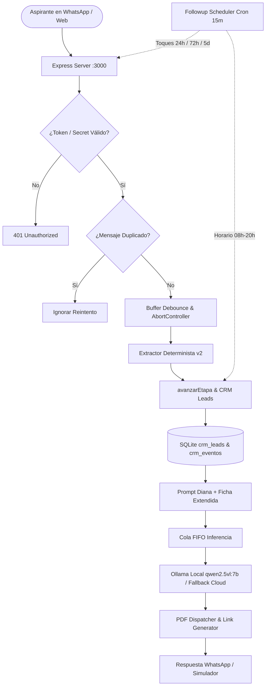

# WhaspiUBE · Asesora Académica Virtual UBE (Diana v2)

Sistema conversacional inteligente, CRM determinista de admisiones y protocolo de seguimiento anti-visto para WhatsApp y Web de la **Universidad Bolivariana del Ecuador (UBE)**. Diseñado con arquitectura híbrida local/nube, memoria persistente (Zero-Amnesia) y embudo de conversión consultivo en 4 turnos.

---

## 🚀 Características Principales (Embudo v2)

- **Máquina de Estados de Admisiones (`session-store.js`):**
  - Estados gobernados por el backend: `lead_nuevo` → `lead_calificado` → `cedula_capturada` → `ficha_completa`.
  - Estados laterales automáticos: `sin_respuesta` (tras el 3er toque) y `en_espera_humano` (handoff para llamada de 5 min).
  - Transiciones basadas exclusivamente en slots verificados, nunca delegadas al criterio del LLM.
- **Protocolo de Seguimiento Anti-Visto (`followup-scheduler.js`):**
  - Evaluación cada 15 min en horario laboral (08h00 a 20h00).
  - **Toque 1 (24 horas):** Retoma el contacto reciclando la pregunta orientadora original.
  - **Toque 2 (72 horas):** Ofrece valor y reserva de cupo por escasez legítima ("se cierra el ciclo").
  - **Toque 3 (5–7 días):** Libera al prospecto sin cerrar la puerta y adjunta tríptico general.
  - **Recordatorio 48h Post-Ficha:** Impulso del siguiente paso según la ruta (enlace de inscripción en grado, checklist documental en validación, reserva de cupo en maestría).
- **Validador Oficial de Cédula (Registro Civil de Ecuador):**
  - Algoritmo estricto módulo 10: provincia 01-24, tercer dígito < 6 (persona natural) y suma ponderada 2-1.
  - Filtro contextual contra números de teléfono celular (`09xxxxxxxx`).
- **Extractor Determinista con "Nombre Desnudo":**
  - Captura respuestas directas a *"¿Con quién tengo el gusto?"* (ej. *"María"*, *"Carlos de Daule"*).
  - Clasificación de ruta (`grado`, `validacion`, `maestria`) y beneficio automático.
  - Prioridad de posgrados (`mba`) sobre grados genéricos (`administra`).
  - Filtro contra negaciones de experiencia (*"no tengo experiencia"*).
- **Dashboard de KPIs y Ritual de los Lunes (Manual Diana · Sección 12):**
  - Bitácora de eventos (`crm_eventos`) que registra cada hito del embudo.
  - Cálculo automático de los 8 KPIs con metas y alertas oficiales.
  - Exportación en un clic a CSV con BOM UTF-8 listo para Excel (`/api/export.csv`).
- **Despacho Inteligente de Trípticos (PDF):**
  - Búsqueda tokenizada por palabras clave sin falsos positivos y fallback a la carrera activa del CRM.
- **Debouncing y Cola de Inferencia Serializada:**
  - Fusión de ráfagas rápidas de mensajes en WhatsApp con AbortController.
  - Cola FIFO global para estabilidad en modelos locales (Ollama).
- **Multimedia y Notas de Voz:**
  - Transcripción de audios con **Groq Whisper Large Turbo**.
  - Reconocimiento de afiches con **RapidOCR** y blindaje anti-prompt injection.
- **Simulador Web & Móvil:**
  - Interfaz de pruebas interactiva en `/` accesible desde navegador y móvil en red local.

---

## 🏗️ Arquitectura del Sistema



---

## 📁 Estructura del Repositorio

```text
WhaspiUBE/
├── wa-bot/                         # Núcleo del Backend en Node.js
│   ├── server.js                   # Orquestador HTTP, endpoints de KPIs y Webhook
│   ├── followup-scheduler.js       # Planificador de toques anti-visto y recordatorios
│   ├── prompt-engine.js            # Prompt maestro Diana UBE y reglas SENESCYT
│   ├── session-store.js            # SQLite CRM, máquina de estados y cálculo de KPIs
│   ├── crm-extractor.js            # Validador Registro Civil, nombres, rutas y objeciones
│   ├── pdf-service.js              # Buscador y despachador tokenizado de trípticos
│   ├── ai-provider.js              # Driver Ollama local + fallback Groq / Gemini
│   ├── audio-processor.js          # Transcriptor Groq Whisper Turbo para notas de voz
│   ├── vision-handler.js           # Orquestador de visión por computadora
│   ├── ocr-processor.py            # Motor RapidOCR
│   ├── wa-client.js                # Cliente WhatsApp Web / Baileys
│   ├── test-embudo.js              # Suite determinista de 53 verificaciones
│   ├── test/                       # Pruebas unitarias de regresión (node:test)
│   │   └── auditoria.test.js
│   ├── public/                     # Simulador Web interactivo
│   │   └── index.html
│   ├── data/                       # Catálogos scraped de la UBE en JSON
│   ├── Dockerfile & docker-compose.yml
│   └── package.json
├── docs/                           # Manuales y Documentación Estratégica
│   ├── catalogo_completo_carreras_ube.md
│   ├── arbol_respuestas_y_prompt_optimizacion.md
│   ├── UBE_Carreras_Grado.md
│   └── UBE_Maestrias_Posgrados.md
├── scripts/                        # Scripts de Scraping y Extracción UBE
│   ├── build_catalogo_md.js
│   ├── descargar_catalogo_ube.py
│   ├── descargar_drive_ube.py
│   ├── extraer_perfiles_acordeon.py
│   └── scrape_ube_full.py
└── README.md
```

---

## ⚙️ Requisitos Previos

- **Node.js** >= 22.13.0 (requerido por `node:sqlite` nativo)
- **Python** >= 3.10 (para OCR opcional con `rapidocr-onnxruntime`)
- **Ollama** con el modelo `qwen2.5vl:7b` (o API Key de Groq / Gemini en `.env`)

---

## 🛠️ Instalación y Puesta en Marcha

1. **Clonar el repositorio:**
   ```bash
   git clone https://github.com/guilleguto-source/WhaspiUBE.git
   cd WhaspiUBE/wa-bot
   ```

2. **Instalar dependencias:**
   ```bash
   npm install
   ```

3. **Configurar variables de entorno:**
   Copiar `.env.example` a `.env`:
   ```bash
   cp .env.example .env
   ```
   Configurar los valores:
   ```env
   PORT=3000
   AI_MODE=hybrid
   OLLAMA_BASE_URL=http://127.0.0.1:11434/v1
   OLLAMA_MODEL=qwen2.5vl:7b
   GROQ_API_KEY=tu_groq_api_key_aqui
   UBE_MATERIAL_DIR=C:\Ruta\A\Tripticos_PDF
   WEBHOOK_TOKEN=tu_token_seguro
   TOQUES_ACTIVOS=true
   ```

4. **Validar las suites de pruebas (61 tests automáticos):**
   ```bash
   # Suite determinista del embudo (53 checks sin LLM)
   node test-embudo.js

   # Suite de regresión unitaria nativa (8 checks)
   npm test
   ```

5. **Iniciar el servidor:**
   ```bash
   node server.js
   ```

6. **Endpoints Principales:**
   - **Simulador Web:** `http://localhost:3000`
   - **Salud del Sistema:** `GET http://localhost:3000/health`
   - **Dashboard KPIs (7 días):** `GET http://localhost:3000/api/kpis?dias=7`
   - **Panel de Leads:** `GET http://localhost:3000/api/leads`
   - **Exportación CSV (Ritual de los Lunes):** `GET http://localhost:3000/api/export.csv?dias=7`

---

## 📄 Licencia

Desarrollado para la gestión y prospección académica de la Universidad Bolivariana del Ecuador (UBE).
