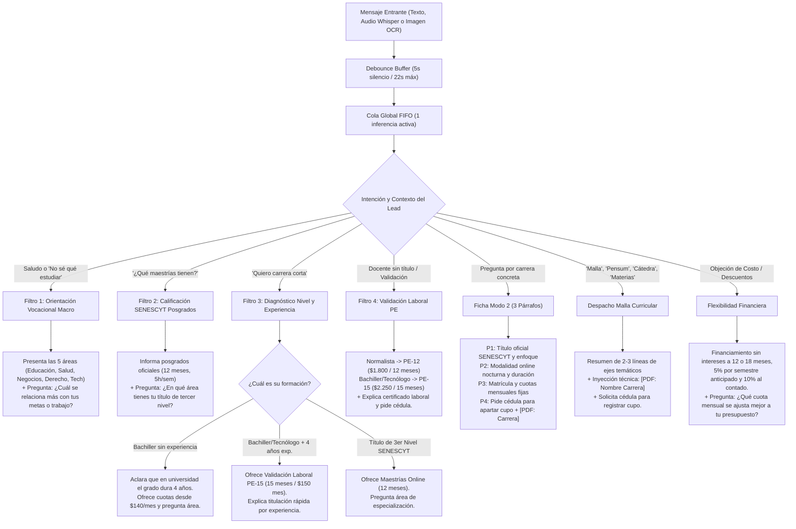

# Arquitectura Comercial y Árbol de Respuestas: Asistente Diana UBE

---

## 1. Mapeo del Árbol de Respuestas y Disparadores Lógicos

---

## 2. Matriz Exhaustiva de Estados: "Qué Desencadena Qué"

| Estado / Nodo | Disparador (Trigger) | Condición Lógica | Acción del Bot (Diana) | Objetivo del Embudo |
|---|---|---|---|---|
| **0. Apertura** | "Hola", "Buenas", nota de voz de saludo. | Historial nuevo / Turno 1. | Saludo formal y cálido + pregunta abierta por área macro. | Iniciar conversación y detectar necesidad. |
| **1. Indecisión Vocacional** | "No sé qué estudiar", "¿Qué carreras hay?", "¿Qué me recomiendan?". | Sin carrera específica en mente. | **Anti-Saturación:** Resume las 5 áreas (Educación, Salud, Negocios, Derecho, Tecnología). Pregunta por afinidad laboral. | Evitar abandono por sobrecarga de opciones. |
| **2. Consulta de Maestrías** | "¿Qué maestrías tienen?", "¿Qué posgrados hay?". | Pregunta general de posgrados. | **Filtro SENESCYT:** Menciona áreas generales (12 meses, 5h/sem) e indaga en qué área tiene su título universitario previo. | Bloquear que bachilleres apliquen a posgrados. |
| **3. Búsqueda de Carrera Rápida** | "Quiero una carrera corta", "algo rápido", "en poco tiempo". | Lead busca inmediatez formativa. | **Filtro de Nivel:** Pregunta si ya tiene título previo o si tiene 4+ años de experiencia laboral. | Enrutar a Grado (4 años), PE-15 (15 meses) o Maestría (1 año). |
| **4. Validación Laboral (Docente)** | "Soy profesor sin título", "doy clases hace años", "valido experiencia". | Mención explícita de docencia en ejercicio. | Diagnóstica PE-12 ($1.800 / 12 meses para normalistas) o PE-15 ($2.250 / 15 meses para bachilleres con 4 años exp.). | Explicar requisitos de certificado laboral y pedir cédula. |
| **5. Ficha de Carrera** | "Información de Derecho", "Educación", "MBA", "Sistemas". | Nombre de carrera identificado. | **Modo 2 Ficha:** 3 párrafos concisos (qué aprende, modalidad online nocturna y costos/cuotas) + solicita dato faltante (cédula). | Despacho de PDF oficial y cierre de cupo. |
| **6. Malla y Pensum** | "Malla", "Pensum", "Materias", "Cátedra", "Luc en educación". | Sinónimos de contenidos curriculares. | Breve síntesis de ejes curriculares + inyección técnica `[PDF: Nombre]` para descarga automática + solicitud de cédula. | Entrega de material oficial y registro de prospecto. |
| **7. Objeción de Precios** | "Está caro", "no me alcanza", "descuentos", "¿cómo se paga?". | Resistencia económica. | Ofrece financiamiento a 12 o 18 meses sin intereses, 5% descuento por semestre y 10% por pago al contado. | Ajustar el pago al flujo de caja del prospecto. |
| **8. Captura de Cédula (Lead Gen)** | Interés confirmado (Turnos 2 al 4). | Faltan Nombre, Cédula o Ciudad. | **Anti-Amnesia:** Pide solo lo faltante. Si ya dio nombre y ciudad, solicita exclusivamente la cédula para apartar cupo promocional. | Formalizar la ficha de admisión en el sistema. |

---

## 3. Catálogo Oficial, Aranceles y Normativa UBE (Ecuador - SENESCYT)

### A. Carreras de Grado Regular (Licenciaturas e Ingenierías - 4 años / 8 semestres):
- **Modalidad:** 100% Online nocturno (clases grabadas) y semipresencial.
- **Oferta:** Derecho, Lic. en Ciencias de la Educación, Lic. en Educación Inicial, Psicología, Enfermería, Fisioterapia, Odontología, IA y Ciberseguridad, Sistemas Inteligentes, Administración de Empresas, Auditoría y Control de Gestión, Contabilidad y Finanzas, Economía.
- **Aranceles:** Inscripción $100 | PRE $150 (6 semanas) | Matrícula $65 (Educación) o $100 (otras) | Cuota regular: $160 a $180/mes (o promoción pronto pago a $140/mes). Módulos de inglés: $110 c/u.

### B. Programas Especiales de Validación por Experiencia Laboral (PE):
- **PE-12 Educación (12 meses):** Arancel total $1.800 (12 cuotas de $150). Exclusivo para docentes con título previo normalista o pedagógico y experiencia laboral.
- **PE-15 Educación, Educación Inicial, Pedagogía Idiomas (15 meses):** Arancel total $2.250 (15 cuotas de $150). Para bachilleres o tecnólogos con mínimo 4 años de experiencia laboral comprobable.
- **Seguridad y Salud Ocupacional (Validación):** Mínimo 4 años de experiencia en salud ocupacional, edad mínima 22 años.
- **Regla Documental Legal:** 
  1º Certificado Laboral (con membrete, cargo exacto, actividades y fechas).
  2º Declaración Juramentada Notarizada (con la misma información).
  *Mecanizado del IESS:* Solo en Lic. en Ciencias de la Educación se acepta el Mecanizado Detallado como sustituto de la declaración notariada.

### C. Maestrías Online Oficiales SENESCYT (12 meses / 49 programas):
- **Requisito excluyente:** Título de Tercer Nivel registrado en SENESCYT.
- **Dedicación:** Solo 5 horas semanales (Sábados o Mar/Jue nocturno).
- **Aranceles y Financiamiento:**
  - Educación Básica: $1.730 total (12x$135.83 o 18x$90.56).
  - Educación Inicial y Neurodesarrollo: $1.650 total (12x$125 o 18x$83.33).
  - MBA (Administración de Empresas): $2.400 total.
  - Derecho Procesal: $2.150 total.
  - Pedagogía Digital e IA para la Educación: $2.000 total.

### D. Políticas Comerciales y Descuentos:
- 5% de descuento por pago anticipado del semestre.
- 10% de descuento por pago al contado completo.
- Descuento de pronto pago cancelando hasta 72 horas antes del vencimiento.
- Financiamiento directo con la universidad sin intereses a 12 o 18 meses.
